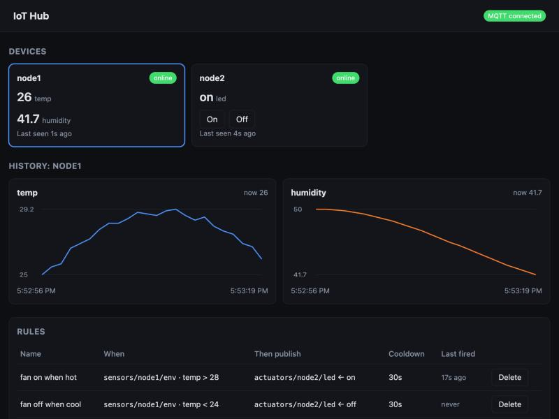

# ESP32 MQTT IoT Hub

[](https://github.com/buzzzed/esp32-mqtt-iot-hub/actions/workflows/iot-hub-ci.yml)

A home IoT hub: ESP32 sensor and actuator nodes, a Python service with a REST API, a rules
engine and a web dashboard, all built around a from-scratch C++ MQTT 3.1.1 broker running on a
Raspberry Pi.



```
 ┌──────────────┐  sensors/node1/env       ┌───────────────────────┐
 │ ESP32 sensor │ ───────────────────────► │                       │
 │  (DHT22)     │  devices/node1/status    │   C++ MQTT broker     │
 └──────────────┘                          │   (epoll + threads)   │
                                           │   Pi :1883            │
 ┌──────────────┐  actuators/node2/led     │                       │
 │ ESP32 LED    │ ◄─────────────────────── │                       │
 │  actuator    │ ───────────────────────► │                       │
 └──────────────┘  .../led/state, status   └──────────┬────────────┘
                                                      │  subscribes to "#",
                                                      │  publishes commands
                                           ┌──────────▼────────────┐
              HTTP  (curl, browser, app)   │  Hub service (Python) │
            ─────────────────────────────► │  FastAPI  :8000       │
                                           │  web dashboard        │
                                           │  rules engine         │
                                           │  SQLite (hub.db)      │
                                           └───────────────────────┘
```

## Layout

```
firmware/                         ESP32 firmware (PlatformIO)
  platformio.ini                  two envs: "sensor" and "actuator"
  include/config.example.h        copy to config.h (gitignored) and fill in
  src/iot_hub_node.cpp            all firmware code
hub/                              Python service on the Pi
  iot_hub/hub_api.py              FastAPI app, endpoints, pruning task
  iot_hub/mqtt_bridge.py          paho-mqtt client: routes messages to DB + rules
  iot_hub/rules_engine.py         rules engine
  iot_hub/hub_storage.py          SQLite schema and queries
  iot_hub/api_schemas.py          request/response validation (pydantic)
  iot_hub/hub_settings.py         settings from environment variables
  iot_hub/static/iot_hub_dashboard.html   web dashboard (no build step, no CDN)
  tests/test_iot_hub.py           unit + API tests (no broker needed)
  iot-hub.service                 systemd unit
.github/workflows/iot-hub-ci.yml  CI: hub tests + compiles both firmware builds
```

## Topic conventions

| Topic | Direction | Payload | Retained |
|---|---|---|---|
| `devices/<id>/status` | device → hub | `online` / `offline` (Last Will) | yes |
| `sensors/<id>/env` | device → hub | `{"temp":22.4,"humidity":41.0}` | no |
| `actuators/<id>/led` | hub → device | `on` / `off` | no |
| `actuators/<id>/led/state` | device → hub | `on` / `off` | yes |

## 1. Firmware

**Hardware**
- Sensor node: DHT22 data → GPIO 4, with a 10 kΩ pull-up to 3.3 V (many breakout boards already have one). VCC → 3.3 V, GND → GND.
- Actuator node: uses the on-board LED on GPIO 2. For an external LED: GPIO 2 → 220 Ω → LED → GND.

**Build and flash (PlatformIO)**
```bash
cd firmware
cp include/config.example.h include/config.h   # then edit Wi-Fi + broker IP
pio run -e sensor -t upload && pio device monitor
pio run -e actuator -t upload
```
The node ID for each env is set in `platformio.ini` (`node1` for the sensor, `node2` for the actuator).

**Arduino IDE:** make a folder `iot_hub_node/`, copy `src/iot_hub_node.cpp` in as `iot_hub_node.ino` and add your
`config.h` next to it. Choose the node type with the `#define NODE_SENSOR` line near the top of
the file, and set `NODE_ID` in `config.h`. Install the libraries *PubSubClient* (Nick O'Leary),
*DHT sensor library* and *Adafruit Unified Sensor*.

## 2 + 3. Hub service

```bash
cd hub
python3 -m venv .venv
.venv/bin/pip install -r requirements.txt
.venv/bin/uvicorn iot_hub.hub_api:app --host 0.0.0.0 --port 8000
```
Open `http://<pi-ip>:8000/` for the dashboard and `http://<pi-ip>:8000/docs` for interactive API docs. To run it at boot, use `iot-hub.service`
(install steps are in the file).

Settings (environment variables): `MQTT_HOST` (default `127.0.0.1`), `MQTT_PORT` (`1883`),
`DB_PATH` (`hub.db`), `OFFLINE_AFTER_SECONDS` (`90`), `READING_RETENTION_DAYS` (`30`; `0` keeps
everything; old readings are pruned hourly).

**Tests** (no broker or hardware needed):
```bash
.venv/bin/pip install -r requirements-dev.txt
.venv/bin/pytest -q
```

### API

| Method | Path | What it does |
|---|---|---|
| GET | `/` | web dashboard |
| GET | `/health` | `{"mqtt_connected": true}` |
| GET | `/devices` | all devices with status and last-seen time |
| GET | `/devices/{id}/latest` | most recent reading |
| GET | `/devices/{id}/history?limit=100` | recent readings, newest first (limit 1–1000) |
| POST | `/devices/{id}/command` | body `{"action":"on"}` → publishes to `actuators/{id}/led` |
| GET | `/rules` | list rules |
| GET | `/rules/{id}` | one rule |
| POST | `/rules` | create a rule |
| DELETE | `/rules/{id}` | delete a rule |

```bash
curl http://pi.local:8000/devices
curl http://pi.local:8000/devices/node1/latest
curl "http://pi.local:8000/devices/node1/history?limit=10"
curl -X POST http://pi.local:8000/devices/node2/command \
     -H 'content-type: application/json' -d '{"action":"on"}'
curl -X POST http://pi.local:8000/rules -H 'content-type: application/json' -d '{
  "name": "fan on when hot", "topic": "sensors/node1/env", "field": "temp",
  "operator": ">", "value": 28, "action_topic": "actuators/node2/led",
  "action_payload": "on", "cooldown_seconds": 30}'
```

### Rules

A rule fires when a live message arrives on a topic matching `topic` (wildcards allowed), its JSON
payload has a numeric `field` (`"env.temp"` reaches into nested objects), `field <operator> value`
is true (`> >= < <= == !=`), and at least `cooldown_seconds` have passed since the rule last fired.
It then publishes `action_payload` to `action_topic`.

Rules are **level-triggered**: while it stays hot, "fan on when hot" re-sends `on` once per
cooldown. That also re-asserts state if a command was lost. Pair it with a second rule
(`temp < 26` → `off`) to get hysteresis.

## Design decisions (useful interview talking points)

**Presence: Last Will plus heartbeat.** On connect, each node registers a Last Will
(`devices/<id>/status` = `offline`, retained). If the node dies without sending DISCONNECT, the
broker notices through the keep-alive timeout (1.5 × 15 s) and publishes the will for it. As a
backup, nodes re-publish `online` every 30 s, and the hub reports any device it hasn't heard from in
90 s as `offline`, even if its retained status still says `online`. So presence stays correct even if
the broker doesn't deliver wills. `/devices` shows both: `status` is what the hub believes,
`reported_status` is what the device last said.

**Retained messages are treated as history, not live data.** When the hub (re)subscribes, the broker
replays retained messages with the retain flag set. The hub records the state they carry, but it
doesn't bump `last_seen`, store them as readings, or run rules on them. Otherwise every hub restart
would mark dead devices alive and re-fire actions.

**Commands are not retained, but state is.** A retained `on` command would replay every time the
actuator reconnects, possibly hours later. Instead the actuator publishes its *actual* state, retained,
on `.../led/state`. Commands go out at QoS 1 so the broker acknowledges them; the endpoint returns
**202 Accepted** because delivery to the device is asynchronous.

**Non-blocking firmware loop.** Wi-Fi and MQTT reconnects run on `millis()` timers (unsigned
subtraction stays correct when `millis()` wraps after about 49 days), so a missing network never
freezes the node. Subscriptions are made in the connect handler, because a clean session forgets them
on every reconnect.

**The PubSubClient buffer gotcha.** The library uses a single buffer for incoming and outgoing
packets, and the callback's `topic`/`payload` point into it. The callback copies what it needs
before it publishes the new LED state.

**Threading in the hub.** paho runs its network loop on one background thread, and every message
callback (storage + rules) runs there, one at a time. That's why the rule cooldown's
check-then-update can't race. HTTP handlers run in FastAPI's thread pool. Both share one SQLite
connection, guarded by a lock, in WAL mode.

**Rule safety.** Validation rejects malformed topic filters, wildcards in `action_topic`, and rules
whose action topic matches their own trigger topic (self-loops). Cycles across several rules are
still possible, but the cooldown limits how fast they can run. A rule only starts its cooldown if
the publish actually succeeded.

### Dashboard

`/` serves one static HTML page that uses the same JSON API as everything else. It shows device
cards with live status and latest readings, On/Off buttons for actuators, charts of a sensor's
recent history, and a table for adding and deleting rules. It refreshes every 5 seconds, needs no
build step, and loads nothing from the internet, so it works on an offline LAN. Charts are hand-drawn
inline SVG. Every value from a device is HTML-escaped before display, because payloads come from
the network.

## Possible extensions
- Authentication on the API and MQTT username/password (PubSubClient's `connect()` supports it).
- Server-sent events or WebSockets so the dashboard updates instantly instead of polling.
